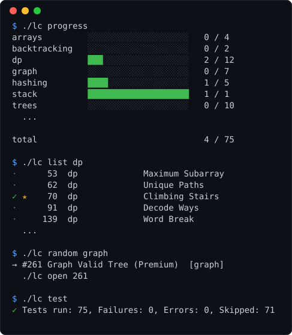

# Java Interview Kit

[](https://github.com/npcBerk/java-interview-kit/actions/workflows/ci.yml)


A ready-to-use **GitHub template** for coding-interview prep in Java. It's offline and works pattern by pattern.

Java 21 · Maven · JUnit 5 + AssertJ · one small CLI (`./lc`)

<p align="center"></p>

## Why

- **Organized by pattern, not by number.** The Blind 75 ships pre-sorted into `slidingwindow/`, `heap/`, `graph/`, `dp/`… so you practice the way interviews test you.
- **Unsolved = skipped, never red.** Each stub throws `UnsupportedOperationException("TODO")`. While that line is there, its tests are reported as *skipped*. Delete it, write your solution and the tests run. `./lc test` stays green, and the skipped count is your to-do list.
- **No LeetCode login, no scraping.** Everything runs locally with `./lc test`. To submit, paste the method body into LeetCode.
- **Your solutions, your repo.** Every copy is your own repository (private if you like). Your solutions, tests and notes live there, and `./lc update` still brings in template improvements without touching them.
- **Notes next to the code.** A mistake log, favorites, a pattern cheat sheet and a Java scratchpad for trying ideas.

## Quick start

1. Click **Use this template → Create a new repository**. Making it **private** is a good idea once your notes get personal.
2. Clone it and check the setup. All you need is **JDK 21+**: Maven comes with the repo through the Maven wrapper, and the first run downloads it.

```bash
./lc list
```

```bash
./lc test
```

3. Pick a problem and solve it:

```bash
./lc random slidingwindow
```

```bash
./lc open 3
```

In the solution file, delete the `throw new UnsupportedOperationException("TODO")` line and write your code. In the test file, replace `addExamples()` with the LeetCode examples and your own edge cases. Then run:

```bash
./lc test 3
```

> **Windows:** `lc` is a Bash script. Run it from [WSL](https://learn.microsoft.com/windows/wsl/install) or Git Bash. The Java code itself works anywhere, so you can also run the tests from your IDE.

## Commands

| Command | What it does |
| --- | --- |
| `./lc list [pattern]` | All problems: `✓` solved, `·` todo, `★` favorite |
| `./lc progress` | Solved / total per pattern |
| `./lc random [pattern]` | A random unsolved problem |
| `./lc open <no>` | Open the solution and its test (Cursor, VS Code or IntelliJ) |
| `./lc test [no]` | Run one problem's tests, or all of them |
| `./lc new <no> <slug> <pattern> [signature]` | Add any problem, e.g. `./lc new 1 two-sum hashing "int[] twoSum(int[] nums, int target)"` |
| `./lc fav <no> [note]` | Add the problem to `notes/favorites.md` |
| `./lc try [file]` | Run `playground/Scratch.java` (or the given file) |
| `./lc update` | Pull the latest CLI, helpers and new stubs from this template (see below) |

## Layout

```
├── lc                              ← the CLI (./lc help)
├── leetcode/                       ← Maven project
│   ├── src/main/java/interviewkit/
│   │   ├── common/                 ← ListNode, TreeNode, Node (+ builders: TreeNode.of(3, 9, 20, null, null, 15, 7))
│   │   └── problems/<pattern>/P<no>_<Name>.java
│   ├── src/test/java/interviewkit/
│   │   ├── support/                ← ProblemTest (TODO → skipped), Grids helpers
│   │   └── problems/<pattern>/P<no>_<Name>Test.java
│   └── templates/                  ← used by ./lc new
├── scripts/
│   ├── blind75.tsv                 ← problem list (number, slug, pattern, title, signature)
│   └── seed.sh                     ← creates missing stubs from a list (default: blind75.tsv)
├── notes/                          ← mistakes, favorites, pattern cheat sheet
└── playground/Scratch.java         ← free experiments
```

## Tips

- Problems marked **(Premium)** need LeetCode Premium. Most of them have free equivalents on LintCode or NeetCode.
- Design problems (Trie, Codec…) use the `P<no>_<Name>` class name. Rename the class to LeetCode's name when you submit.
- Want a different list (NeetCode 150, Grind 75, your company's tagged list)? Write a TSV in the same format as `scripts/blind75.tsv` and run `scripts/seed.sh path/to/list.tsv`. Problems you already have are skipped. For a single problem, use `./lc new`.
- VS Code's **Live Run** task (`.vscode/tasks.json`) re-runs the open Java file on every save. It needs [`entr`](https://eradman.com/entrproject/): `brew install entr` or `apt install entr`.

### Getting template updates into your copy

```bash
./lc update
```

This adds this repo as a `template` remote and updates only the files the template owns: the `lc` CLI, `scripts/`, the code templates, `common/` and `support/` helpers, the Maven wrapper and `notes/patterns.md`. It also creates stubs for any newly added problems. Your solutions, tests and notes are never touched. Check the result with `git status`, then commit.

## Contributing

Issues and PRs are welcome. See [CONTRIBUTING.md](CONTRIBUTING.md).

## License

[MIT](LICENSE). Problem statements belong to LeetCode. This repo only links to them and does not copy them.
